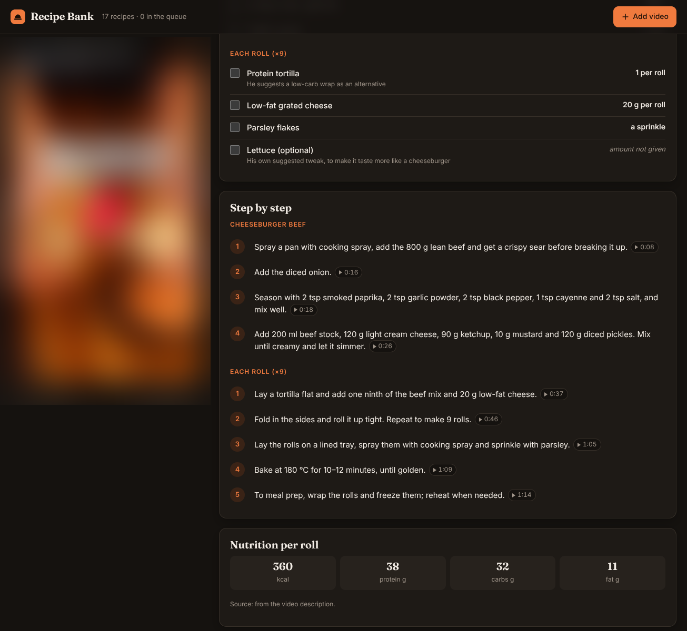

# Recipe Bank

Turn the cooking videos you save into recipes you can actually cook from.



Recipe Bank keeps short recipe videos (today YouTube, including Shorts, TikTok and Instagram Reels; more platforms are planned) as structured recipes: the ingredients in the creator's own amounts, and step-by-step instructions whose timestamps jump straight to that moment in the embedded video. A small dashboard filters the collection by what you have in the fridge and builds a shopping list.

## Who it's for

Me, first: I save a lot of cooking videos and could never find the one I wanted, or work out the amounts, when it was time to cook. It suits anyone who wants a private, searchable cookbook built from short-form videos, without retyping every recipe by hand.

## What it does

- **Filter by ingredient.** Pick ingredients and switch between *Has all* and *Has any*, or search by dish or creator.
- **Cook from the video.** Each recipe embeds the original video. Every step has a "play from here" timestamp, and you can tick off ingredients as you go.
- **Shopping list.** Copy a recipe's ingredients as a shopping list.
- **Honest amounts.** Amounts are the creator's own words ("1 can", "about 1 cup"). When a video doesn't say, the recipe says "amount not given" instead of guessing, and recipes with a withheld method are marked *partial* with the gaps listed.
- **Queue new videos.** Paste a video link to add it to the queue for analysis.
- **Credit.** Every recipe links back to the creator and the original video. Videos are embedded from the platform, never re-hosted.

## Built with

- Node.js 22 and nothing else: no runtime dependencies, no framework, no build step for development.
- `node:http` server with a small JSON API (`server.mjs`).
- Vanilla ES-module dashboard with light and dark themes (`public/`).
- A recipe schema with a validator (`lib/recipe.mjs`, `npm run validate`) and tests on the built-in `node:test` runner.
- Static export for Cloudflare Pages (`npm run build`).

## Run it

Requires Node.js 22 or newer.

```bash
git clone https://github.com/axeltoll/recipe-bank.git
cd recipe-bank
npm start          # dashboard at http://127.0.0.1:4780 (PORT / HOST to override)
```

Other commands:

```bash
npm run dev        # restarts on server/lib changes
npm run validate   # checks every recipes/*.json and data/queue.json
npm test           # URL parsing and recipe-contract tests
npm run build      # static copy in dist/ (read-only: "Add video" copies a request instead of queueing)
npm run site       # previews the public website in site/ at http://127.0.0.1:4790
npm run site:data  # regenerates site/data/showcase.js from the showcased recipe files
npm run site:sync  # rewrites the website's generated parts after editing site/data/features.json or site.json
```

## Project layout

| Path | What |
|---|---|
| `recipes/<id>.json` | One file per recipe. The format is documented in [CLAUDE.md](CLAUDE.md) and enforced by `lib/recipe.mjs`. |
| `data/queue.json` | Videos waiting for analysis. |
| `lib/` | Video-URL parsing and the recipe contract, shared by the server, the validator and the browser. |
| `server.mjs` | Static files plus the JSON API (`/api/recipes`, `/api/queue`). |
| `public/` | The dashboard. |
| `site/` | The public website for the project (static, separate from the dashboard): home page, docs and changelog. What it says about each feature comes from `site/data/features.json`. See [site/README.md](site/README.md). |
| `scripts/` | Validator, static build, and the website's preview server, sample-data generator and sync script. |
| `test/` | `node:test` suites. |

## Plans

See [ROADMAP.md](ROADMAP.md). Next up: a week plan with a combined shopping list, household planning with a food budget, and a self-hosted Recipe Agent that turns a video link into a recipe with the coding agent you already use.

## License

[MIT](LICENSE). The license covers this repository's code and recipe files. The videos belong to their creators; Recipe Bank only links to and embeds them.
